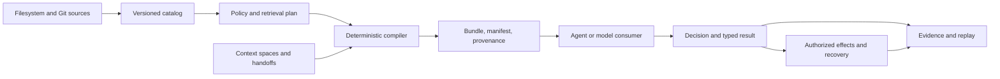

# CIGAR: Open-Source Context Engineering for AI Agents

[](https://crates.io/crates/hol-cigar)
[](https://pypi.org/project/hol-cigar/)
[](https://www.npmjs.com/package/@hol-org/cigar)
[](https://pypi.org/project/hol-cigar/)
[](https://docs.rs/hol-cigar)
[](https://github.com/hashgraph-online/hol-cigar/actions/workflows/fast-ci.yml)
[](https://github.com/hashgraph-online/hol-cigar/actions/workflows/security.yml)
[](./LICENSE)
[](https://github.com/hashgraph-online/hol-cigar/stargazers)
[](https://deepwiki.com/hashgraph-online/hol-cigar)

|  | **Give AI agents the right context, with citations, inside an exact token budget.** CIGAR (Context Intelligence Graph Agentic Runtime) is an open-source context engineering protocol and runtime from [HOL](https://hol.org) for governed retrieval, multi-agent handoffs, MCP, provenance, recoverable effects, and replay.<br><br>[CIGAR on hol.org](https://hol.org/cigar)<br>[Read the documentation](docs/README.md)<br>[Rust crate (`hol-cigar`)](https://crates.io/crates/hol-cigar) · [PyPI (`hol-cigar`)](https://pypi.org/project/hol-cigar/) · [npm (`@hol-org/cigar`)](https://www.npmjs.com/package/@hol-org/cigar)<br>[Report an Issue](https://github.com/hashgraph-online/hol-cigar/issues) |
| :--- | :--- |

CIGAR builds a local context graph from the sources you supply and compiles a small, cited
context for each agent request. The rendered result fits an exact token budget, keeps every
required dependency, and records where each line came from. Agents read less, and the host can
check what they were shown.

Local context graphs work without HOL services, an account, API keys, a daemon, or a database.
Use the Rust crate directly, or `LocalContextGraph` from Python's `cigar_sdk` or npm's
`@hol-org/cigar/context`; both SDKs run a bundled Rust worker. Their separate `CigarClient` APIs
connect to a CIGAR server you choose.

[Install](#install-cigar) · [What CIGAR does](#what-cigar-does) · [How it works](#how-it-works) ·
[Why CIGAR](#why-cigar) · [FAQ](#frequently-asked-questions) · [Releases](#release-history) ·
[Documentation](#documentation) · [Development](#development) · [Security](#security)

## Install CIGAR

| Language | Package | Install |
| --- | --- | --- |
| Rust | [`hol-cigar`](https://crates.io/crates/hol-cigar) | `cargo add hol-cigar` |
| Python 3.14 | [`hol-cigar`](https://pypi.org/project/hol-cigar/) | `python3.14 -m pip install --upgrade 'hol-cigar==0.14.2'` |
| Node.js `>=24.22.1 <25` | [`@hol-org/cigar`](https://www.npmjs.com/package/@hol-org/cigar) | `npm install --save-exact @hol-org/cigar@0.14.0` |

### Rust

```toml
[dependencies]
hol-cigar = "0.14.2"
```

```rust
use hol_cigar::{ContextGraph, ContextRequest, Document, EdgeKind, GraphLimits, Utf8ByteCounter};

let mut graph = ContextGraph::new("my-project", GraphLimits::default())?;
graph.upsert(Document::new("retry", "src/retry.rs", "Retry only idempotent operations."))?;
graph.upsert(Document::new("contract", "docs/api.md", "A retry must keep the original operation ID."))?;
graph.link("retry", "contract", EdgeKind::Requires)?;
let request = ContextRequest { query: "idempotent retry".into(), max_tokens: 2000, ..ContextRequest::default() };
let snapshot = graph.compile(&request, &Utf8ByteCounter)?;
println!("{}", snapshot.render());
```

Enable the `bpe` feature for exact o200k_base token counts. The [crate guide](crates/cigar-context/README.md)
covers budgets, citations, scoped views, answer review and hosting the worker in your own process.

### Python

```sh
python3.14 -m pip install --upgrade 'hol-cigar==0.14.2'
python3.14 -m cigar_sdk.local_cli doctor
python3.14 -m cigar_sdk.local_cli demo
```

The [Python guide](sdk/python/README.md) covers ingestion, exact context budgets, citations, source
updates and answer review. A normal wheel install bundles the worker; workerless source builds need
explicit opt-in and a trusted matching worker path.

### Node.js

The npm package is **`@hol-org/cigar`** (`hol-cigar` is the Python and Rust name). It runs on macOS
ARM64/x64, Linux ARM64/x64 with glibc or musl, and Windows x64. Save this as `context.mjs` and run
`node context.mjs`:

```js
import { LocalContextGraph } from "@hol-org/cigar/context";

const graph = await LocalContextGraph.create("my-project");
try {
  await graph.replaceSource("docs/retries.md", [
    {id: "retry-policy", source: "docs/retries.md", text: "Retry at most three times."},
  ]);
  const result = await graph.compile({query: "retry", max_tokens: 512, reserve_tokens: 64});
  console.log(result.rendered);
} finally {
  await graph.close();
}
```

Keep the graph open across requests to reuse its indexes and token cache. Supply document text
yourself; `source` is a citation locator and does not open a file. See the
[TypeScript guide](sdk/typescript/README.md).

## What CIGAR Does

| Workflow | What CIGAR provides |
| --- | --- |
| Context compilation | Ranked, cited context from your sources that fits an exact token budget and keeps hard dependencies whole. |
| Shared context for many agents | One local broker serves independent Python and Node agents with host-issued, authenticated source scopes, quotas and fair admission. |
| Answer review | Each claim in a draft answer must cite selected evidence and carry a trusted review before it is released. |
| Two-agent collaboration | Fork private work, issue a signed and attenuated handoff, accept it once, and merge a typed result against an exact base. |
| Recoverable external actions | Record intent before dispatch, keep `UNKNOWN` after ambiguous execution, then reconcile or compensate explicitly. |
| Replay and audit | Rebuild declared inputs, verify retained evidence, or replay recorded observations without contacting a live provider. |
| Agent integration | Use the CLI, embedded runtime, local daemon, MCP server, Claude Code adapter, or the Rust, Python and TypeScript SDKs. |

## How It Works



1. **Observe sources.** Filesystem and Git connectors discover content under explicit source
   identities, exclusions, lifecycle rules, and integrity metadata.
2. **Plan under policy.** A context contract fixes purpose, principal, projects, consistency,
   trust constraints, token lanes, compiler profile, and catalog watermark.
3. **Compile deterministically.** CIGAR sorts, deduplicates, filters, budgets, materializes, and
   hashes selected context into an immutable bundle and manifest.
4. **Coordinate bounded work.** Context spaces keep immutable bases, private overlays,
   checkpoints, signed handoffs, typed changes, and explicit conflicts.
5. **Handle actions as effects.** External mutation is split into intent, authorization,
   dispatch, observation, reconciliation, and compensation. Ambiguous execution stays `UNKNOWN`.
6. **Keep observable evidence.** Decisions bind inputs, policy, context, runtime fingerprints,
   outputs, effects, observations, and uncertainty without requesting hidden chain-of-thought.

The public protocol defines seven services: catalog, context, spaces, handoffs, effects, replay,
and operations. See the [public API reference](docs/reference/public-api.md).

## Why CIGAR

Agent systems assemble context, call tools, hand work to other agents, and retry after partial
failures. Without an explicit runtime contract those steps are hard to govern or reproduce: source
text blurs into instruction authority, prompt construction is invisible, tool outcomes are mistaken
for certainty, and audit logs omit the context that shaped a decision.

CIGAR makes that decision environment explicit. It sits between source systems and an agent or
model runtime and provides:

- deterministic, provenance-bearing context bundles instead of opaque prompt concatenation;
- policy enforcement before protected content is disclosed;
- recipient-bound handoffs with attenuated authority and typed result merging;
- durable effect intent, authorization, dispatch, reconciliation, and compensation;
- evidence reproduction and no-egress observational replay; and
- content-safe operational signals without storing hidden model reasoning.

CIGAR is model-agnostic. It is not a model, hosted agent service, autonomous scheduler, or
replacement for an application-specific orchestrator.

## Frequently Asked Questions

### What is CIGAR?

CIGAR (Context Intelligence Graph Agentic Runtime) is an open-source context engineering protocol
and runtime for AI agents, built by [HOL](https://hol.org). It compiles cited, token-budgeted
context from your sources, governs what each agent may read, and records evidence so a decision
can be checked or replayed later.

### Does CIGAR need a server, account or API key?

No. Local context graphs run in-process (Rust) or through a bundled local worker (Python and npm).
They need no HOL services, account, API keys, daemon or database. The remote `CigarClient` APIs
are optional and connect only to a server you choose.

### How does CIGAR reduce the tokens an agent reads?

It selects only the documents that match the request, keeps their hard dependencies whole, drops
duplicates, and renders the result inside an exact token budget measured with the real tokenizer.
In the 0.9.4 Hiero workflow comparison, selected context used 50% fewer exact tokens than 0.9.3 with
the same coverage. Savings depend on the workload and are not guaranteed for every input.

### Is CIGAR a RAG library or a vector database?

CIGAR does not require a vector database or embedding model. It uses a lexical index over a
context graph with explicit `Requires`, `Supports`, `Related` and `Contradicts` edges. If you already
have an embedding index, pass its ranked IDs as semantic candidates; they still go through the
same access and dependency checks.

### Does CIGAR work with MCP and Claude Code?

Yes. The repository includes an MCP server, a Claude Code adapter, a CLI and a local daemon. See
the [MCP and Claude Code guide](docs/guides/honey-mcp-claude.md).

### Which languages does CIGAR support?

Rust (`hol-cigar` on crates.io), Python (`hol-cigar` on PyPI, imported as `cigar_sdk`) and
TypeScript/Node.js (`@hol-org/cigar` on npm). Go SDK source is in `sdk/go`.

### Is CIGAR production-ready?

CIGAR is alpha software. The local context SDKs are published and tested on seven platforms; the
separate Honey runtime profile is unsupported evaluation software that is not production-qualified,
signed, or notarized. See [current status](#current-status).

## Release History

### 0.14.2: faster exact token counting

The o200k counter loads only the tables it uses, and Python worker startup and pipe handling are
faster. The broker adds atomic ticket consumption. Token counts and tokenizer identity are
unchanged. See the [0.14.2 release notes](docs/release/context-sdk-0.14.2-notes.md). The
[0.14.1 security release](docs/release/context-sdk-0.14.1-notes.md) added compilation work limits,
Python HTTP deadlines and requires patched Node.js `>=24.22.1 <25`.

### 0.14.0: shared context for independent agents

One local broker can serve independent Python and Node agent processes with host-issued,
authenticated source scopes. The host controls evidence admission, reviewer verdicts and execution
authority. Per-agent quotas, fair admission, source revision conflicts and expiring tickets bound
shared work. Optional SQLite persistence restores admitted context with a fresh authority epoch after
restart.

The development load matrix passed 2,379,985 cycles at 1/5/12 processes and the fault matrix passed
3,879 checks. The 24-hour twelve-agent soak completed 1,036,800 cycles with 23 forced worker
recoveries. Node client RSS kept growing within the 2 GiB aggregate cap, so a memory plateau is
unproven. These are offline measurements, not a real-model hallucination claim. See the
[release notes](docs/release/context-sdk-0.14.0-notes.md), [soak report](docs/release/context-sdk-0.14.0-soak.md),
[installed comparison](docs/release/context-sdk-0.14.0-installed-comparison.md) and
[broker guide](sdk/LOCAL_BROKER_GUIDE.md).

The broker authenticates loopback clients; it is not an OS sandbox or an encrypted multi-host
service. A trusted host keeps policy and review authority.

### 0.12.0: faster startup

Compared with 0.11.0 on one macOS ARM64 host: Python local API import 59.06 ms → 6.50 ms, import plus
first graph 109.72 ms → 62.83 ms, and worker-hashing allocation 7.29 MB → 1.18 MB. Some native
medians rose up to 7.4%. See the [full comparison](docs/release/context-sdk-0.12.0-comparison.md).

### 0.11.0: answer review

Added a bounded answer-review contract: current authorized evidence, exact claim and snapshot
bindings, independent trusted verdicts, citation checks, distinct source groups and explicit
counterevidence. CIGAR does not certify truth; the host supplies its reviewer. See the
[release notes](docs/release/context-sdk-0.11.0-notes.md) and
[answer-quality tools](benches/answer-quality/README.md).

### CIGAR Honey 0.9.4 candidate

Honey is the first bounded CIGAR runtime profile for hands-on local evaluation on Apple-silicon
macOS, with embedded and local-sidecar modes, filesystem and Git ingestion, and CLI, daemon, MCP and
Claude Code workflows. Its `balanced_v4` profile, measured over 250 observations per version on five
governed Hiero workflows:

| Metric | 0.9.2 / `balanced_v1` | 0.9.3 / `balanced_v3` | 0.9.4 / `balanced_v4` |
|---|---:|---:|---:|
| Valid completion and blocking/gold/citation coverage | 100% | 100% | **100%** |
| Useful-selection precision | 27.1% | 50.0% | **100%** |
| Semantic duplicate rate | 46.1% | 0% | **0%** |
| Mean exact selected tokens | 2,251.05 | 1,251.78 | **625.40** |
| Internal CIGAR pipeline p50 | 2.049 ms | 1.852 ms | **0.738 ms** |
| Internal CIGAR pipeline p95 | 7.658 ms | 3.268 ms | **1.216 ms** |

These are deterministic, source-bound measurements, not installed-artifact, live-model,
security-certification, or universal performance claims. See the
[Hiero three-way report](docs/release/honey-0.9.4-hiero-three-way-comparison.md),
[0.9.4 release notes](RELEASE_NOTES_HONEY_v0.9.4.md) and the
[artifact-oriented Honey README](README_HONEY.md).

## Current Status

| Property | Value |
|---|---|
| Project | [HOL.org](https://hol.org) alpha project |
| Local context SDKs | Rust `hol-cigar`, Python `hol-cigar`, npm `@hol-org/cigar` |
| Context ABI | `cigar.context.v1` |
| Honey runtime profile | `0.9.4` candidate, `aarch64-apple-darwin`, unsupported evaluation software |
| Production qualification | False |
| Signing and notarization | Not included for Honey |

Machine-readable authorities take precedence over prose:

- [`packaging/product-version.v1.json`](packaging/product-version.v1.json): version and publication state;
- [`packaging/honey/capability-profile.v1.json`](packaging/honey/capability-profile.v1.json): selected capabilities and platform;
- [`packaging/honey/artifact-matrix.v1.json`](packaging/honey/artifact-matrix.v1.json): exact artifact inventory;
- [`packaging/honey/release-requirements.v1.json`](packaging/honey/release-requirements.v1.json): mandatory gates and prohibited claims;
- [`packaging/pypi/release-profile.v1.json`](packaging/pypi/release-profile.v1.json) and
  [`packaging/npm/release-profile.v1.json`](packaging/npm/release-profile.v1.json): package identities and qualification gates.

Progress toward the broader CIGAR v1 design is tracked in
[`IMPLEMENTATION_STATUS.md`](IMPLEMENTATION_STATUS.md) against [`prd.md`](prd.md). Code presence
does not mean a surface is selected, packaged, qualified, published, or supported.

## Documentation

- [Documentation index](docs/README.md)
- [Core concepts](docs/guides/concepts.md)
- [Rust crate guide](crates/cigar-context/README.md)
- [Python guide](sdk/python/README.md) · [TypeScript guide](sdk/typescript/README.md) · [SDK guides](docs/guides/sdks.md)
- [Local broker guide](sdk/LOCAL_BROKER_GUIDE.md)
- [Honey installation](docs/guides/honey-install.md) · [Honey offline quickstart](docs/guides/honey-quickstart.md)
- [Two-agent workflow](docs/guides/honey-two-agent.md)
- [Handoffs, effects, and replay](docs/guides/handoffs-effects-replay.md)
- [MCP and Claude Code](docs/guides/honey-mcp-claude.md)
- [Operations](docs/operations/index.md) · [Troubleshooting](docs/troubleshooting/index.md)
- [Release verification](docs/release/verification.md)

## Development

Install the versions in [`support.toml`](support.toml), then:

```sh
cargo xtask bootstrap
cargo xtask test unit
python3 scripts/dev.py context
```

`bootstrap` validates required tools and generated artifacts; it does not install software or fetch
missing dependencies. Tests are hermetic and offline.

| Path | Contents |
|---|---|
| `crates/` | Rust protocol, catalog, compiler, policy, space, effects, replay, storage, API, daemon, CLI, MCP, and support crates. `crates/cigar-context` is the `hol-cigar` crate. |
| `sdk/` | Python, TypeScript, Rust, and Go SDK source and contract tests. |
| `adapters/`, `connectors/` | Claude Code and source-system integrations. |
| `spec/`, `schemas/`, `proto/` | Versioned operations, payloads, schemas, and transport contracts. |
| `conformance/` | Conformance runners, vectors, and install qualification tools. |
| `demos/` | Deterministic context, handoff, effect, replay, and injection-defense scenarios. |
| `packaging/`, `scripts/release/` | Product authority, artifact producers, verifiers, and qualification workflows. |
| `docs/` | Guides, API reference, operations, troubleshooting, release verification, and design documentation. |
| `artifacts/`, `reports/` | Implementation and test records; not automatically evidence for a later source revision. |

## Security

CIGAR's authority, integrity, and traceability controls operate inside a single local-user trust
boundary. They are not process isolation between hostile programs running as that user. Read
[security and limitations](docs/guides/honey-security-limitations.md) before using CIGAR with
sensitive material.

Report vulnerabilities through the private process in [`SECURITY.md`](SECURITY.md). Do not publish
private source, prompts, credentials, handoff capsules, transcripts, or diagnostic archives.

## Resources

- [CIGAR on hol.org](https://hol.org/cigar)
- [HOL Guard: open-source antivirus for AI agents](https://github.com/hashgraph-online/hol-guard)
- [HOL Standards Documentation](https://hol.org/docs/standards)
- [Model Context Protocol Documentation](https://modelcontextprotocol.io)
- [HOL GitHub Organization](https://github.com/hashgraph-online)

## Community

Maintained by [HOL](https://hol.org).

- [Report a bug or request a feature](https://github.com/hashgraph-online/hol-cigar/issues)
- [Browse GitHub releases](https://github.com/hashgraph-online/hol-cigar/releases)
- [Read the crate docs on docs.rs](https://docs.rs/hol-cigar)

## License

Licensed under [Apache-2.0](LICENSE).
